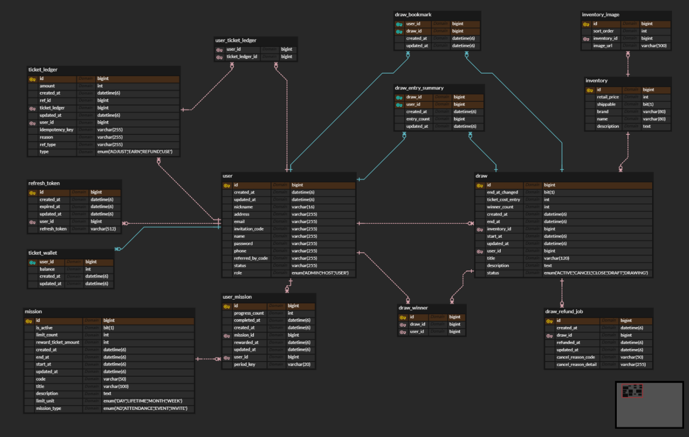

LuckyDrop

> 티켓으로 원하는 경품 이벤트에 응모하고, 공정한 추첨 결과를 확인하는 드로우 플랫폼

LuckyDrop은 사용자가 미션으로 티켓을 획득한 뒤 원하는 드로우에 응모하고, 주최자는 경품 이벤트를 생성·운영할 수 있도록 만든 서비스입니다. 단순한 CRUD를 넘어, **응모·티켓 차감·추첨**처럼 데이터 정합성이 중요한 흐름을 안정적으로 처리하는 데 중점을 두었습니다.

## 프로젝트 소개

온라인 이벤트는 응모 수가 많아질수록 중복 처리, 티켓 잔액 오류, 종료된 이벤트에 대한 참여, 추첨 중복 실행 같은 문제가 발생하기 쉽습니다. LuckyDrop은 드로우의 상태를 명확히 관리하고, 티켓 거래를 원장으로 남기며, 주기적인 스케줄러로 이벤트 전환과 추첨을 자동화합니다.

- **프로젝트 유형**: 티켓 기반 경품 추첨 플랫폼
- **개발 범위**: 백엔드 REST API
- **API 문서**: Swagger UI (`/swagger-ui.html`)

## 핵심 기능

| 구분 | 기능 |
| --- | --- |
| 회원 | 회원가입, 로그인/로그아웃, JWT 토큰 재발급, 프로필·비밀번호 관리, 이메일 인증 |
| 드로우 | 경품 이벤트 생성·수정·목록·상세 조회, 인기 배너, 취소 및 관리자 강제 취소 |
| 응모 | 티켓을 사용한 다회 응모, 내 응모 내역·통계 조회 |
| 추첨 | 종료 시점에 맞춘 자동 추첨, 가중치 기반 당첨자 선정, 당첨자 조회 |
| 티켓·미션 | 티켓 지갑·거래 원장, 출석·광고·드로우 미션 보상 |
| 부가 기능 | 드로우 북마크, 이미지 업로드, 관리자 기능 |

## 서비스 흐름

flowchart LR
    A[회원가입 및 로그인] --> B[미션 수행]
    B --> C[티켓 적립]
    C --> D[드로우 탐색]
    D --> E[티켓으로 응모]
    E --> F[응모 및 티켓 거래 기록]
    F --> G[이벤트 종료]
    G --> H[자동 추첨]
    H --> I[당첨 결과 확인]
```

| 영역 | 적용 기술 | 사용 목적 |
| --- | --- | --- |
| API 서버 | Java 21, Spring Boot 3.5, Spring MVC | REST API 및 비즈니스 로직 구현 |
| 인증·인가 | Spring Security, JWT | Stateless 인증 처리 |
| 데이터 접근 | Spring Data JPA, MySQL | 도메인 데이터 영속화 및 조회 |
| 캐시 | Redis | 이메일 인증 코드의 임시 저장 |
| 문서화 | springdoc-openapi, Swagger UI | API 명세 및 테스트 환경 제공 |
| 자동화 | Spring Scheduler | 드로우 상태 전환 및 자동 추첨 |

## 도메인 설계



핵심 도메인은 `User`, `Draw`, `TicketWallet`, `TicketLedger`, `DrawEntrySummary`, `DrawWinner`로 구성했습니다.

- `Draw`는 이벤트 정보와 상태, 응모 기간, 당첨 인원을 관리합니다.
- `TicketWallet`은 사용자의 현재 티켓 잔액을 관리합니다.
- `TicketLedger`는 티켓 적립·사용·조정 이력을 남겨 잔액 변동을 추적합니다.
- `DrawEntrySummary`는 드로우별 사용자 응모 횟수를 집계해 반복 응모를 효율적으로 관리합니다.
- `DrawWinner`는 추첨 결과를 별도 저장해 결과 조회와 재실행 방지에 사용합니다.

## 핵심 설계와 문제 해결

### 1. 드로우 상태 기반의 이벤트 생명주기 관리

드로우를 `DRAFT → ACTIVE → DRAWING → CLOSE`로 관리해, 사용자가 참여 가능한 시점과 추첨 가능한 시점을 명확히 분리했습니다. 스케줄러가 1분마다 시작·종료 시간을 확인하여 상태를 전환하고, `DRAWING` 상태의 이벤트만 자동 추첨합니다.

이 구조로 종료된 이벤트 응모와 미완료 이벤트의 결과 노출을 방지했습니다.

### 2. 티켓과 응모를 하나의 트랜잭션으로 처리

응모는 티켓 차감과 응모 횟수 증가가 함께 성공해야 합니다. 두 작업을 트랜잭션 안에서 처리해 한 작업만 반영되는 불일치를 방지했습니다.

- 티켓 잔액을 잠금 조회해 동시 요청에서의 잔액 오류를 줄였습니다.
- `idempotencyKey`를 티켓 원장에 저장해 같은 요청의 중복 처리를 방지했습니다.
- 응모 횟수는 upsert 방식으로 집계해 사용자·드로우별 요약 데이터를 유지했습니다.

### 3. 응모 횟수를 반영한 가중치 추첨

응모 횟수가 많을수록 당첨 가능성이 높아지도록 가중치 기반 무작위 추첨을 구현했습니다. 각 후보의 응모 횟수를 가중치로 사용하고, 한 사용자가 중복 당첨되지 않도록 선정합니다.

또한 추첨 시작 시 상태를 원자적으로 `DRAWING → CLOSE`로 변경하고, 이미 당첨자가 저장된 드로우는 재추첨하지 않도록 방어했습니다.

### 4. 사용자 경험을 고려한 기능 분리

드로우 탐색, 북마크, 인기 배너, 내 응모 현황, 미션 보상 기능을 분리해 사용자가 이벤트 참여 전후에 필요한 정보를 쉽게 확인할 수 있도록 구성했습니다. 당첨자 닉네임은 마스킹하여 결과 공개 시 개인정보 노출을 줄였습니다.

## API 구성

| 도메인 | 주요 엔드포인트 |
| --- | --- |
| 사용자·인증 | `/api/user/**`, `/api/signup/**` |
| 드로우 | `/api/draws/**`, `/api/admin/draws/**` |
| 응모 | `/api/draws/{drawId}/entry`, `/api/draws/my-entries` |
| 북마크 | `/api/draws/{drawId}/bookmark`, `/api/draws/bookmarks` |
| 티켓 | `/api/ticket/**` |
| 미션 | `/api/missions/**` |
| 이미지 | `/api/images` |

전체 API 명세와 요청·응답 예시는 서버 실행 후 Swagger UI에서 확인할 수 있습니다.

## 기술 스택

`Java 21` · `Spring Boot 3.5` · `Spring Security` · `Spring Data JPA` · `MySQL` · `Redis` · `JWT` · `Gradle` · `Swagger`

## 프로젝트 구조

```text
src/main/java/luckydrop/demo
├── common/       # JWT, 보안 설정, 공통 예외 처리
├── user/         # 회원 및 인증
├── draw/         # 드로우, 추첨, 취소, 북마크, 이미지
├── entry/        # 응모 및 응모 통계
├── ticket/       # 티켓 지갑과 거래 원장
├── mission/      # 출석·광고·드로우 미션
└── email/        # 이메일 인증과 비밀번호 재설정
```

## 향후 개선 방향

- 추첨 로직의 난수 생성·검증 과정을 별도 기록하여 결과 투명성 강화
- 테스트 케이스 확대: 동시 응모, 중복 요청, 추첨 상태 전환
- 운영 환경의 시크릿을 환경 변수 또는 시크릿 매니저로 일원화
- 이미지 저장소를 외부 오브젝트 스토리지로 분리
